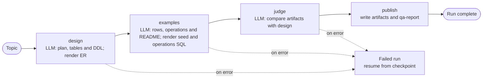

# db-pet-gen

Generate a small, documented database pet project from **one topic**. The result
is a PostgreSQL-compatible SQL schema, seed data, a Mermaid ER diagram, and a
comprehensive English `README.md` for the generated project.

The generator is a **design and documentation tool**: it validates model-written SQL and Markdown
and renders the ER diagram and seed SQL from checked tables and rows. Nothing is executed
against a database.

## Contents

- [Quick start](#quick-start)
- [A complete example](#a-complete-example)
- [Configuration](#configuration)
- [CLI reference](#cli-reference)
- [Pipeline](#pipeline)
- [Data contracts and example data](#data-contracts-and-example-data)
- [Validation rules](#validation-rules)
- [Run outputs](#run-outputs)
- [Failures and resume](#failures-and-resume)
- [Observability and development](#observability-and-development)
- [Source layout](#source-layout)
- [Limits and guarantees](#limits-and-guarantees)

## Quick start

Node.js 24.21.0 (see `.nvmrc`) is recommended. A configured chat model is needed
to generate projects; tests use a fake model and need no network or database.

```sh
nvm use
npm install
cp .env.example .env
# Edit LLM_PROVIDER, LLM_MODEL and LLM_API_KEY in .env.
npm run build
npm start -- generate "Pet records"
```

The command prints the run id and the workspace path; the generated project is
at `artifacts/runs/<run-id>/README.md`. Each run gets its own directory.

## A complete example

A topic is the only input. For example (the run shown below is one of the
checked-in example runs):

```sh
npm start -- generate "Public library database"
```

Terminal output (progress goes to stderr, the result to stdout; on a TTY the
stage lines are shown as a spinner instead):

```text
Run started: 20261121-092452-public-library-database-018b02
Workspace: /Users/you/db-pet-gen/artifacts/runs/20261121-092452-public-library-database-018b02
design: stage started
design: stage finished
examples: stage started
examples: stage finished
judge: stage started
judge: stage finished
publish: stage started
publish: stage finished

Generated: /Users/you/db-pet-gen/artifacts/runs/20261121-092452-public-library-database-018b02/README.md
Run id: 20261121-092452-public-library-database-018b02
QA: /Users/you/db-pet-gen/artifacts/runs/20261121-092452-public-library-database-018b02/qa-report.json
Log: /Users/you/db-pet-gen/artifacts/runs/20261121-092452-public-library-database-018b02/events.jsonl
```

Run ids have the form `<YYYYMMDD-HHMMSS>-<slug>-<hex>`, for example
`20261121-092452-public-library-database-018b02`. The slug is the ASCII-folded,
lowercase topic (at most 48 characters, `database` when empty) and the suffix is
three random bytes. The generated workspace looks like this:

```text
artifacts/runs/<run-id>/
  README.md                   The documented project (main deliverable)
  assets/
    ddl/schema.sql             PostgreSQL-compatible DDL
    seed/seed.sql              Sample data
    operations/operations.sql  Named SQL examples from “Operations and queries”
    diagrams/er.mmd            Mermaid ER source (also embedded in README)
  run.json                     Status, model identity, current stage
  events.jsonl                 Timestamped stage event log
  checkpoints.db               LangGraph SQLite checkpoints for resume
  run.lock                     Exclusive SQLite ownership lock
  qa-report.json               Pass/fail report
```

The data and artifact examples below use the small **Pet records** example from
the project's offline test fixture; the lifecycle examples are taken from the
checked-in **Public library database** run. All of it is data the codebase
actually produces.

## Configuration

Settings come from `.env` (loaded at startup) and are validated with Zod. Copy
`.env.example` and fill in at least the provider, model and API key:

```dotenv
LLM_PROVIDER=openrouter
LLM_MODEL=openai/gpt-4o-mini
LLM_API_KEY=your-key
LLM_TEMPERATURE=0
LLM_JSON_MODE=on
LLM_MAX_TOKENS=8192
LLM_MAX_RETRIES=6
RUNS_DIR=artifacts/runs
OBSERVABILITY_PROVIDER=none
PHOENIX_COLLECTOR_ENDPOINT=http://localhost:6006
PHOENIX_PROJECT_NAME=db-pet-gen
```

| Variable                     | Default                       | Purpose                                                          |
| ---------------------------- | ----------------------------- | ---------------------------------------------------------------- |
| `LLM_PROVIDER`               | required                      | `openrouter`, `opencode` or `groq`                               |
| `LLM_MODEL`                  | required                      | Model id for the OpenAI-compatible chat API                      |
| `LLM_API_KEY`                | required                      | API key; never written to a manifest, event log or diagnostic    |
| `LLM_BASE_URL`               | provider default (see below)  | Alternative OpenAI-compatible endpoint                           |
| `LLM_TEMPERATURE`            | `0`                           | Sampling temperature, from `0` to `2`                            |
| `LLM_JSON_MODE`              | `on`                          | `on` sends `response_format: json_object`; `off` omits it        |
| `LLM_MAX_TOKENS`             | `8192`                        | Positive integer token cap                                       |
| `LLM_MAX_RETRIES`            | `6`                           | Retries of a refused model call (exponential backoff)            |
| `LLM_MAX_CONCURRENCY`        | `1` for Groq, otherwise unset | Caps side-by-side calls to stay inside a per-minute token budget |
| `RUNS_DIR`                   | `artifacts/runs`              | Parent directory for run workspaces                              |
| `OBSERVABILITY_PROVIDER`     | `none`                        | `none` or `phoenix`                                              |
| `PHOENIX_COLLECTOR_ENDPOINT` | `http://localhost:6006`       | Phoenix OTLP/HTTP collector                                      |
| `PHOENIX_PROJECT_NAME`       | `db-pet-gen`                  | Phoenix project name                                             |

Default `LLM_BASE_URL` values:

| Provider     | Base URL                         |
| ------------ | -------------------------------- |
| `openrouter` | `https://openrouter.ai/api/v1`   |
| `opencode`   | `https://opencode.ai/zen/v1`     |
| `groq`       | `https://api.groq.com/openai/v1` |

A custom `LLM_BASE_URL` requires HTTPS (HTTP is allowed on loopback only), with
no credentials, query string or fragment. Provider JSON mode is advisory: the schema still travels in every
prompt and answers are validated with Zod afterwards, because some models ignore
or wrap provider-level JSON. Refused calls are retried with exponentially growing
waits; a rate limit that outlives those retries fails the run with advice to
lower `LLM_MAX_CONCURRENCY` or `LLM_MAX_TOKENS`. To switch models, edit `.env`
and start a new run.

## CLI reference

```text
db-pet-gen generate <topic>   Generate a project from one topic
db-pet-gen resume <run-id>    Retry a failed or interrupted run
db-pet-gen --help             Show help
db-pet-gen --version          Show the version (1.0.0)
```

With `npm start --`, pass the arguments after `--`:

```sh
npm start -- generate "Public library database"
npm start -- resume 20261121-092452-public-library-database-018b02
```

A topic is trimmed, must be one line of at most 160 characters, and cannot be
empty. The generated README, QA report and event log paths are printed on
success; failures print the run id, stage, error and the exact resume command.

## Pipeline

Each run compiles the same four-stage LangGraph pipeline. The first three stages
ask the model for Zod-validated JSON (two attempts each); `publish` is
deterministic code:



| Stage      | Kind              | What it produces and checks                                                            |
| ---------- | ----------------- | -------------------------------------------------------------------------------------- |
| `design`   | model, 2 attempts | Checks the tables and PostgreSQL DDL, then renders and parses the Mermaid ER source    |
| `examples` | model, 2 attempts | Checks rows, operations and README, then renders seed and operations SQL               |
| `judge`    | model, 2 attempts | `Judge` JSON; must report `matches: true` with no problems, or the answer is corrected |
| `publish`  | deterministic     | Writes the five checkpointed artifacts plus a passing `qa-report.json`                 |

An unusable answer is sent back to the model once with the exact rejection and a
request to return matching JSON. The client owns transport retries; provider
error text is never sent to the model. Completed stages are
restored from SQLite checkpoints on resume instead of being asked again.

## Data contracts and example data

The model stages exchange three checked JSON objects. Fields with Zod defaults
may be omitted by the model; the limits below are enforced before a stage can
succeed.

| Object     | Shape and constraints                                                                                                                                          |
| ---------- | -------------------------------------------------------------------------------------------------------------------------------------------------------------- |
| `Design`   | `title` (≥3 chars), `summary` (≥20 chars), `assumptions` (1–6 strings), `features` (2–8 strings), `tables` (2–8), `ddl` (string); the generator adds `mermaid` |
| `Examples` | `tables` (every design table once, in order, 2–5 rows each), `operations` (2–12), `readme` (string); the generator adds `seedSql` and `operationsSql`          |
| `Judge`    | `matches` (boolean), `problems` (array of strings)                                                                                                             |

A table has a `name`, `comment`, `checks` (always empty), `indexes` and at least
one column. A column has a `name`, a `type` from `INTEGER`, `BIGINT`, `SMALLINT`,
`REAL`, `NUMERIC`, `TEXT`, `VARCHAR`, `BOOLEAN`, `DATE`, `TIMESTAMP`, and optional
flags: `primaryKey`, `nullable`, `unique`, `length`, `defaultValue`,
`references: { table, column }` and `comment`. Parent tables are listed before
children, foreign keys point to an earlier table's primary/unique column of the
same type, and at least one foreign key is required. Every table needs a non-null
primary key. Table and index names share a namespace; column names must be unique
within their table.

Each seed row supplies exactly the designed columns, with the expected JSON
value types and nullability. Primary and unique keys (including composite keys)
must be distinct, and each non-null foreign key must match a seeded parent.

For the `Pet records` topic the design data is:

```json
{
  "title": "Pet records",
  "summary": "A small catalogue that records pet owners and the animals in their care.",
  "assumptions": ["Each animal has exactly one registered owner."],
  "features": ["List pets by their owner.", "Remove an outdated pet record."],
  "tables": [
    {
      "name": "owners",
      "comment": "People responsible for pets",
      "checks": [],
      "indexes": [],
      "columns": [
        {
          "name": "id",
          "type": "INTEGER",
          "primaryKey": true,
          "nullable": false
        },
        { "name": "name", "type": "TEXT", "nullable": false }
      ]
    },
    {
      "name": "pets",
      "comment": "Animals registered in the system",
      "checks": [],
      "indexes": [{ "name": "idx_pets_owner", "columns": ["owner_id"] }],
      "columns": [
        {
          "name": "id",
          "type": "INTEGER",
          "primaryKey": true,
          "nullable": false
        },
        {
          "name": "owner_id",
          "type": "INTEGER",
          "nullable": false,
          "references": { "table": "owners", "column": "id" }
        },
        { "name": "name", "type": "TEXT", "nullable": false }
      ]
    }
  ]
}
```

The `mermaid` and `ddl` strings of that same `Design` object hold the ER source
and schema shown under [Generated artifacts](#generated-artifacts). The example
data and operations of the `Examples` object are:

```json
{
  "tables": [
    {
      "table": "owners",
      "rows": [
        { "id": 1, "name": "Ada" },
        { "id": 2, "name": "Sam" }
      ]
    },
    {
      "table": "pets",
      "rows": [
        { "id": 10, "owner_id": 1, "name": "Milo" },
        { "id": 11, "owner_id": 2, "name": "Poppy" }
      ]
    }
  ],
  "operations": [
    {
      "name": "list_pets_by_owner",
      "title": "Find pets for an owner",
      "tables": ["pets"],
      "parameters": ["owner_id"],
      "statement": "SELECT id, owner_id, name FROM pets WHERE owner_id = :owner_id"
    },
    {
      "name": "remove_pet",
      "title": "Remove a pet record",
      "tables": ["pets"],
      "parameters": ["id"],
      "statement": "DELETE FROM pets WHERE id = :id"
    }
  ]
}
```

The judge reviews the DDL, seed SQL, operations, diagram and README against these checked objects:

```json
{ "matches": true, "problems": [] }
```

### Generated artifacts

`assets/ddl/schema.sql` — one `create table` per designed table, then the
indexes:

```sql
create table "owners" ("id" integer not null, "name" text not null, constraint "pk_owners" primary key ("id"));
create table "pets" ("id" integer not null, "owner_id" integer not null, "name" text not null, constraint "pk_pets" primary key ("id"), constraint "fk_pets_owner_id" foreign key ("owner_id") references "owners" ("id"));
create index "idx_pets_owner" on "pets" ("owner_id");
```

`assets/seed/seed.sql` — one `insert` per seed table, using only the checked
values:

```sql
insert into "owners" ("id", "name") values (1, 'Ada'), (2, 'Sam');
insert into "pets" ("id", "owner_id", "name") values (10, 1, 'Milo'), (11, 2, 'Poppy');
```

`assets/operations/operations.sql` — the checked statements in order, labeled
by operation name. Choose an example and supply its named parameters:

```sql
-- list_pets_by_owner
SELECT id, owner_id, name FROM pets WHERE owner_id = :owner_id;

-- remove_pet
DELETE FROM pets WHERE id = :id;
```

`assets/diagrams/er.mmd` — the Mermaid source, also embedded in the generated
README:

```mermaid
erDiagram
"owners" {
  INTEGER `id` PK
  TEXT `name`
}
"pets" {
  INTEGER `id` PK
  INTEGER `owner_id` FK
  TEXT `name`
}
"owners" ||--o{ "pets" : "owner_id"
```

The generated `README.md` follows a fixed structure: title, `Project overview`,
`Design`, `ER diagram`, `Data dictionary`, `Sample data`, `PostgreSQL setup`,
`Operations and queries` and `Limitations`, plus a
`Relationships (text alternative)` subsection for viewers without Mermaid
support. For this example it documents two owners, two pets, both operations and
the setup commands:

```sh
createdb db_pet_gen_demo
psql -v ON_ERROR_STOP=1 -d db_pet_gen_demo -f assets/ddl/schema.sql
psql -v ON_ERROR_STOP=1 -d db_pet_gen_demo -f assets/seed/seed.sql
```

An excerpt of that generated README shows how the checked design and seed rows
are presented:

````markdown
## Data dictionary

### owners

People responsible for pets.

#### Columns

- `id` — INTEGER; PK: Yes; FK: —; nullable: No; unique: No; default: —; description: Owner identifier.
- `name` — TEXT; PK: No; FK: —; nullable: No; unique: No; default: —; description: Full name.

#### Explicit indexes

- None declared.

### pets

Animals registered in the system.

#### Columns

- `id` — INTEGER; PK: Yes; FK: —; nullable: No; unique: No; default: —; description: Pet identifier.
- `owner_id` — INTEGER; PK: No; FK: owners.id; nullable: No; unique: No; default: —; description: Registered owner.
- `name` — TEXT; PK: No; FK: —; nullable: No; unique: No; default: —; description: Pet name.

#### Explicit indexes

- `idx_pets_owner` on `owner_id` (non-unique).

## Sample data

The seed script is [assets/seed/seed.sql](assets/seed/seed.sql). These counts
describe generated rows, not a live database:

- `owners`: 2 seed rows
- `pets`: 2 seed rows

#### owners records

```json
[
  { "id": 1, "name": "Ada" },
  { "id": 2, "name": "Sam" }
]
```
````

Named parameters such as `:owner_id` in the operations require application
binding before the statements can run in `psql`.

## Validation rules

The model supplies DDL, operation statements and Markdown. The generator renders Mermaid from checked
tables and parses it before checkpointing the design. A renderer failure stops the stage
without a corrective model turn. Zod checks seed rows against the designed columns and foreign-key
values. remark parses the README; micromark supplies the tokens used to check
that every code fence closes. Beyond syntax and allowed links, the generator compares parsed DDL
table and column names and base types to the design, and the single embedded ER diagram to the checked asset.

| Artifact       | Library           | Checks                                                                                                                                                                                  |
| -------------- | ----------------- | --------------------------------------------------------------------------------------------------------------------------------------------------------------------------------------- |
| DDL            | `node-sql-parser` | PostgreSQL dialect; only `create table` and `create index` statements                                                                                                                   |
| Seed SQL       | `@pgsql/quotes`   | One multi-row `insert` per checked table, in design column order, with PostgreSQL string quoting                                                                                        |
| Operations     | `node-sql-parser` | Exactly one `SELECT`/`INSERT`/`UPDATE`/`DELETE`; physical tables match the declared, unqualified design names; CTE names are local to their query; used `:params` match declared params |
| ER source      | `mermaid`         | Official parser; `erDiagram` first; entities, column types and `PK`/`FK`/`UK` markers match the design; one line per FK                                                                 |
| Project README | `remark`          | One title; all eight required sections; text fallback; inline Mermaid fence; no raw HTML or unclosed fences; local links                                                                |

Identifiers must be safe to render unquoted and must not be reserved words.
Only identifiers, column types and fixed Mermaid syntax enter the ER diagram.
README links may only point to
`assets/ddl/schema.sql`, `assets/seed/seed.sql`, `assets/operations/operations.sql`, `assets/diagrams/er.mmd` or a
fragment; external, absolute and `..` links are rejected.

The stage instructions are separate from the topic and artifact JSON. A passing
report means deterministic checks passed and the judge returned `matches: true`
with no problems. The judge's assessment of constraints, operations and prose
is a model opinion, not proof of semantic equivalence. None of the SQL is executed: the
generator never starts or claims to have tested a PostgreSQL instance.

## Run outputs

A successful `qa-report.json`:

```json
{
  "verdict": "pass"
}
```

`run.json` records the graph version, topic, status, current stage, process id,
resumption count, per-stage attempts and timings, and the model identity
(provider, name, base URL and temperature — never the API key):

```json
{
  "version": 11,
  "runId": "20261121-092452-public-library-database-018b02",
  "topic": "Public library database",
  "status": "completed",
  "stage": null,
  "pid": 11822,
  "resumptions": 1,
  "error": null,
  "model": {
    "provider": "openrouter",
    "name": "nvidia/nemotron-3-ultra-550b-a55b:free",
    "baseUrl": "https://openrouter.ai/api/v1",
    "temperature": 0.1
  }
}
```

`events.jsonl` is an append-only, timestamped log. A resumed run keeps the
earlier events, including the failure:

```jsonl
{"at":"2026-11-21T09:30:01.029Z","runId":"20261121-092452-public-library-database-018b02","kind":"stage_failed","stage":"examples","detail":"The model did not return a usable examples: the answer was not a JSON object"}
{"at":"2026-11-21T09:30:01.038Z","runId":"20261121-092452-public-library-database-018b02","kind":"run_failed","stage":"examples","detail":"The model did not return a usable examples: the answer was not a JSON object"}
{"at":"2026-11-21T09:30:23.252Z","runId":"20261121-092452-public-library-database-018b02","kind":"run_resumed","stage":null,"detail":""}
{"at":"2026-11-21T09:30:23.335Z","runId":"20261121-092452-public-library-database-018b02","kind":"stage_started","stage":"examples","detail":""}
{"at":"2026-11-21T09:32:58.529Z","runId":"20261121-092452-public-library-database-018b02","kind":"stage_finished","stage":"examples","detail":""}
```

`checkpoints.db` is the LangGraph SQLite checkpoint store used by `resume`.
`qa-report.json` is written on failure too:

```json
{
  "verdict": "failed",
  "stage": "examples",
  "issue": "The model did not return a usable examples: the answer was not a JSON object"
}
```

## Failures and resume

When a stage fails, the run id, stage, error and the resume command are printed,
and `run.json`, `events.jsonl` and `qa-report.json` preserve the details:

```sh
npm start -- resume <run-id>
```

Generate and resume hold an exclusive SQLite transaction on `run.lock` through
shutdown. The OS releases it when a process exits, including after a crash;
leave the lock file in place. Resume continues a pending checkpoint without
repeating completed model calls. If the checkpoint is missing, it starts at
design on a fresh thread. If publication finished before the manifest was
finalized, it restores the generated files and the QA report from the terminal
checkpoint without calling the model. An unreadable store is an error; restore
a good backup or start a new run.

Resume refuses a completed run, an active lock, a different graph version
(including older runs checked under weaker QA rules), or a run whose provider,
model, base URL or temperature in `.env` differs from the original run. Start a
new run if you need different model settings.

## Observability and development

Progress appears on stderr (a spinner on a terminal; plain stage lines in
redirected logs). `events.jsonl` is the persistent stage event log. Phoenix
tracing is optional:

```sh
npm run phoenix:up
# Set OBSERVABILITY_PROVIDER=phoenix in .env
npm start -- generate "Library lending"
npm run phoenix:down
```

Phoenix uses <http://localhost:6006>; the Docker service is optional. The
generator exports stage names, durations and success/failure status. It never
attaches model inputs, outputs, credentials or provider error text to spans.

To plug in a different backend, pass a provider factory as the second argument
of `createTraceAdapter` in `src/index.ts`. The factory creates one provider per
run and takes precedence over `OBSERVABILITY_PROVIDER`. Its `startStage(name)`
returns a callback that receives `'ok'` or `'error'`; `shutdown()` flushes the
provider when the run ends. The built-in Phoenix implementation lives in
`src/adapters/observability/providers/phoenix/`.

```sh
npm run build
npm run typecheck
npm run lint:check
npm run format:check
npm test
```

`npm install` wires the hooks in `.githooks/` via `npm run prepare`. Run that
command manually if the hooks do not fire. The pre-commit hook checks lint and
formatting; the pre-push hook also runs the tests. Tests use injected fake model
responses and need no network or database.

## Source layout

The layout follows ports and adapters. `src/workflows/` is the core and owns
the use case, the domain and the port interfaces; `src/cli/` is the driving
adapter; `src/adapters/` holds the driven adapters; `src/index.ts` is the
composition root that wires them together. Generic cross-cutting helpers with
no domain meaning live in the neutral `src/shared/` module.

```text
src/
  cli/                      Commander commands and terminal progress
  config/
    env.ts                  Builds AppConfig from validated environment values
    env.schema.ts           Environment variable schema
  shared/                   Generic diagnostics (redact, error helpers)
  workflows/
    ports/                  Inbound use case and outbound port interfaces
    generate/
      domain/               Checked data schemas, run manifest and paths
      rules/                DDL, operation and README validation
      render/               ER diagram, seed SQL and operations SQL renderers
      stages/               Prompt, verifier and output for each stage
      pipeline/             LangGraph wiring and state schema
      useCase.ts            First run and resume
      journal.ts            Run-state transitions over the ports
  adapters/
    llm/                    Provider client, rate limits, validated JSON requests
    run-store/              Workspace, manifest, events, checkpoints and lock
    artifacts/              Writes the checked files into a run
    observability/          Stage tracing and pluggable providers
    testing/                Offline fixture and fake model
```

Each module has an `index.ts` barrel and colocated tests.

## Limits and guarantees

- The generator produces setup scripts and documentation, not a running
  application or a packaged database.
- Generated designs have 2–8 tables, 2–5 seed rows per table, 2–12 operations,
  and only the column types listed above.
- SQL targets portable PostgreSQL syntax. No PostgreSQL instance is started,
  and no generated statement is executed or reported as tested.
- Operation statements are parsed and checked, but named parameters need
  application-level binding before use in `psql`.
- API keys are never stored in the manifest and are redacted from errors,
  events and diagnostics.
